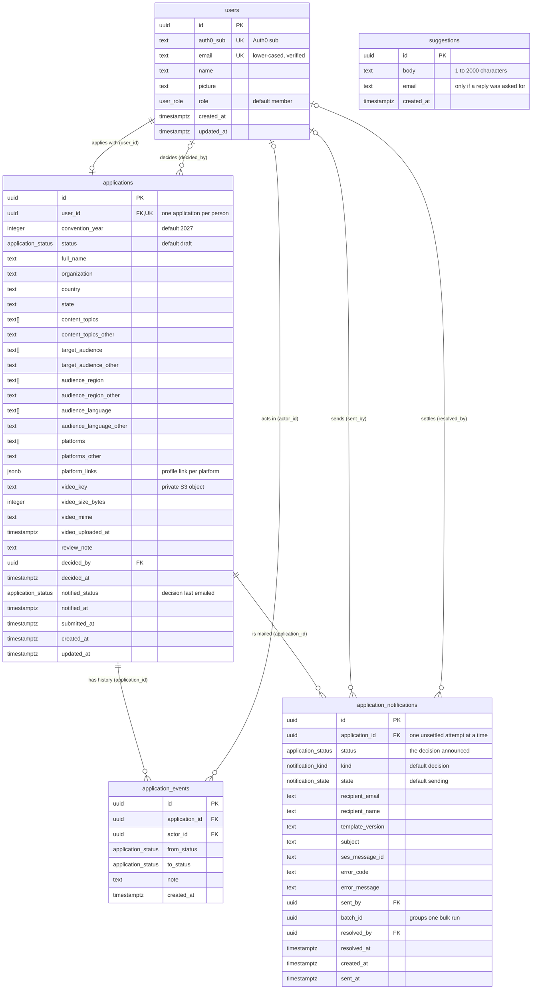

# Buddhist Creators

The website for [Buddhist Creators](https://buddhistcreators.com), a global sangha of monastics, practitioners and storytellers carrying the Dharma to the digital age through a convention, awards and campaigns.

## Pages

| Route | What's there |
| --- | --- |
| `/` | Mission, programs, what's on, partners and the suggestion box |
| `/get-involved` | Ways to take part as a creator, partner or supporter |
| `/program` | Ongoing, upcoming and past programs |
| `/convention/2026` | Buddhist Creators Convention 2026 in Bodh Gaya |
| `/convention/2027` | Buddhist Creators Convention 2027 in Nagpur |
| `/convention/2027/register` | The convention application form (sign-in required) |
| `/admin` | The selection committee's dashboard (admin role required) |
| `/people` | The team and the creators |

## Tech stack

- [Next.js](https://nextjs.org) 16 (App Router) with React 19 and TypeScript
- [Tailwind CSS](https://tailwindcss.com) v4
- [Base UI](https://base-ui.com) and [shadcn/ui](https://ui.shadcn.com) components
- [Phosphor Icons](https://phosphoricons.com)
- [Auth0](https://auth0.com) for sign-in, [Drizzle](https://orm.drizzle.team) on Postgres (Render) for applications, S3 for intro videos

## Development

```bash
npm install
npm run dev
```

Open [http://localhost:3000](http://localhost:3000). No environment variables are needed.

## Scripts

- `npm run dev` starts the dev server
- `npm run build` builds for production
- `npm run start` serves the production build
- `npm run lint` runs ESLint

## Project structure

```text
app/         Routes, metadata, social cards, sitemap and robots.txt
components/  Page sections, grouped by page, with shared UI in components/ui
lib/         Page content, navigation and site constants
public/      Images served by the site
assets/      Fonts and images used at build time, plus this README's banner
```

## Editing content

Most copy lives in typed data files in `lib/`, so it can be changed without touching the components:

| File | Content |
| --- | --- |
| `lib/home.ts` | Homepage copy |
| `lib/get-involved.ts` | Get Involved page |
| `lib/events.ts` | Events listing |
| `lib/convention-2026.ts` | Convention 2026 page |
| `lib/convention-2027.ts` | Convention 2027 page, including the registration switch |
| `lib/people.ts` | Team and creators |
| `lib/creator-card.ts` | Creator card form: copy and option lists |
| `lib/navigation.ts` | Site navigation, name, URL and default description |

Events are grouped by hand rather than by date, so move an entry to the right list once it passes.

## Suggestion box

The homepage suggestion box saves each suggestion to the `suggestions` table (`lib/suggestions.ts`, called from `submitFeedback` in `app/actions.ts`), and admins read them at `/admin/suggestions`, newest first; a superadmin can remove one. The send button shows the save in progress and its outcome, and a toast confirms it.

## Creator cards

A creator card says who a creator is, what they make and where to find it:
a photo, display name, country, whether they create as a monastic, lay
practitioner, organization or teacher, the languages they publish in, the
kinds of content they make, one line about their work, and their links.

The photo is the picture from the creator's sign-in account unless they
upload their own. An upload is cropped square, scaled to 512 pixels and
compressed in the browser, sent with the form, checked on the server (one
WebP or JPEG, at most 512 KB) and stored in the private S3 bucket under
`creator-cards/<user id>/`, a new object for each upload; the card's
`photo_key` names it and pages load it through a presigned URL. A new photo
is a change to the card like any other, so it goes back for review, and the
object it replaces is deleted.

A signed-in creator fills theirs in at `/creator-card`, with the card drawn
beside the form as they type, and submits it for review. The form then
behaves as the registration form does: it is read-only behind an Edit card
button, editing offers Save changes and Cancel, and the actions float at the
foot of the screen. Admins and superadmins review at `/admin/creator-cards`:
approve, or reject with a note the creator reads on their card page. A
creator can edit their card at any time, and every change, even to an
approved card, goes back to pending, so nothing is approved unread. A review names the version of the card it read
and is refused if the creator has changed the card since.

| Piece | Where |
| --- | --- |
| Option lists, copy, validation | `lib/creator-card.ts` |
| Reads and writes, status rules | `lib/creator-cards.ts` |
| The card itself | `components/creator-card/creator-card.tsx` |
| Preparing an uploaded photo in the browser | `components/creator-card/photo.ts` |
| The form | `app/(site)/creator-card/` |
| Review | `app/admin/creator-cards/` |

One table, `creator_cards`. Only `display_name` is required and `user_id`
may be null: the team will also make cards for creators it knows from
details it only partly has, and such a card has no owner until its creator
claims it. Claiming is not built yet, and approved cards are not shown on
the public site yet.

## Registration and the admin dashboard

Applicants sign in through Auth0 (Google or Apple) and fill in the form at
`/convention/2027/register`. They can save a draft, upload a 2-minute intro
video, submit, and keep editing until the committee decides. Admins review at
`/admin`: accept, reject or waitlist each application, with a note and a
history of every change, then email the decision, one applicant at a time or
everyone waiting in a tab. Admins read the suggestion box at
`/admin/suggestions`. Superadmins can also remove a suggestion there, and
manage roles at `/admin/users`.

How it fits together:

| Piece | Where |
| --- | --- |
| Auth0 client and sign-in gate | `lib/auth0.ts`, `proxy.ts` |
| Who is calling, roles | `lib/auth.ts`, `lib/auth-roles.ts` |
| Database schema and client | `lib/db/schema.ts`, `lib/db/index.ts`, migrations in `drizzle/` |
| Client-side writes (React Query) | `components/query-provider.tsx`, `components/form/form-helpers.ts`, `lib/session-ended.ts` |
| Form copy, option lists, validation | `lib/registration-2027.ts` |
| Reads and writes, status transitions | `lib/applications.ts` |
| S3 (private bucket, presigned reads) | `lib/s3.ts`; intro videos through `app/api/applications/video/route.ts`, card photos through the card's save action |
| Decision emails: who is owed one, sending, the send ledger | `lib/notifications.ts`, `lib/ses.ts` |
| Wording of the three emails | `lib/emails/accepted.ts`, `rejected.ts`, `waitlisted.ts` |
| The form | `app/convention/2027/register/` |
| The dashboard | `app/admin/` |

### How client code talks to the server

Pages read their data in server components. Client components that write
(every form here, the video upload, the bulk send) run their server action
or request as a [React Query](https://tanstack.com/query) mutation
(`useMutation`), which supplies the pending state, the result and the
failure; what happens on a result is in the mutation's callbacks, not in an
effect. Forms send themselves from `onSubmit` with their own `FormData`
rather than through the form's `action`, because React resets a form after
its action and that unticks checkboxes ticked since the page loaded.
Mutations are tried once and at once, online or not. A request that fails
outright is checked against `/auth/profile` to tell an ended session from a
lost connection (`lib/session-ended.ts`).

### Data model

Six tables, defined in `lib/db/schema.ts`. The diagram shows the five
behind registration; `creator_cards` is described under Creator cards
above. `suggestions` stands alone: a suggestion is never tied to a user.



Deleting a user deletes their application, and deleting an application
deletes its events and notifications. The other links to `users`
(`decided_by`, `actor_id`, `sent_by`, `resolved_by`) are set to null instead,
so the history outlives the admin who made it.

| Enum | Values |
| --- | --- |
| `user_role` | `member`, `admin`, `superadmin` |
| `application_status` | `draft`, `submitted`, `accepted`, `rejected`, `waitlisted`, `withdrawn` |
| `notification_state` | `sending`, `sent`, `failed`, `uncertain` |
| `notification_kind` | `decision`, `resend` |
| `creator_card_status` | `pending`, `approved`, `rejected` |

### Setting it up

1. Copy `.env.example` to `.env.local` and fill it in.
2. **Auth0**: create a *Regular Web Application*. Allowed Callback URLs
   `{APP_BASE_URL}/auth/callback`, Allowed Logout URLs `{APP_BASE_URL}`.
   Enable the `google-oauth2` connection on it.
3. **Database**: create a Postgres on Render, put its external URL in
   `DATABASE_URL`, then run the migrations:

   ```bash
   npm run db:migrate
   ```

   After changing `lib/db/schema.ts`, run `npm run db:generate` to write a
   new migration, then `npm run db:migrate`.
4. **S3**: create a private bucket (block all public access, no CORS
   needed) and an IAM user with `s3:PutObject`, `s3:GetObject`,
   `s3:DeleteObject` and `s3:AbortMultipartUpload` on it.
5. **First superadmin**: sign in once on the site, then in the database:

   ```sql
   update users set role = 'superadmin' where email = 'you@example.com';
   ```

   From then on roles are managed at `/admin/users`.

### Decision emails

Saving a decision never emails anyone. An applicant is owed an email while
their status is accepted, rejected or waitlisted and differs from the decision
they were last emailed, so a changed decision is owed again and nobody is
written to twice for the same one. Design and reasoning:
`docs/design/decision-emails.md` and `docs/adr/0001-decision-emails-via-ses.md`.

- **Wording.** One file per email in `lib/emails/`. To change one, edit its
  subject or paragraphs and change `version`, which is stored with every
  send. Setting `approved: false` stops the live site sending that email.
- **`EMAIL_DELIVERY`.** `off` (the default) sends nothing. `simulate` runs
  everything with a fake transport and only against a local database; an
  address starting `fail+` is refused and one starting `timeout+` never
  answers. `live` sends real mail: to applicants only from the production
  site, and anywhere else only the "Send me a test" link in the bulk dialog.
- **A send that never confirmed** (a timeout, a crash) shows as "needs
  review" and blocks that applicant until an admin records whether it
  arrived. Nothing is retried automatically.

The SES account, the DNS records, the IAM permissions and the move to
`buddhistcreators.com` are written up in
[`docs/setup/domain-and-email-setup.md`](docs/setup/domain-and-email-setup.md):
what was set up, the exact records and policies, what is still to do before
sending goes live, and the error messages met along the way.

To take the form offline, set `REGISTRATION.open` to `false` in
`lib/convention-2027.ts`; the register button is shown disabled.
