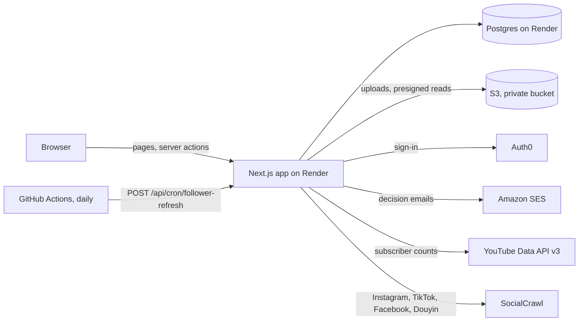
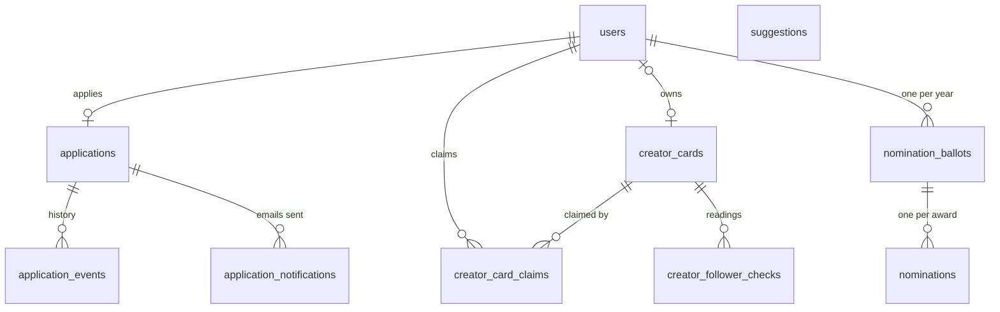

# Architecture

One Next.js 16 app, served as a single Node service on Render, with
Postgres for data, a private S3 bucket for uploads, Auth0 for sign-in and
Amazon SES for email. A GitHub Actions schedule calls the app once a day to
read follower counts.



## Stack

- [Next.js](https://nextjs.org) 16 (App Router, Cache Components) with
  React 19 and TypeScript
- [Tailwind CSS](https://tailwindcss.com) v4, [Base UI](https://base-ui.com)
  and [shadcn/ui](https://ui.shadcn.com), [Phosphor Icons](https://phosphoricons.com)
- [TanStack Query](https://tanstack.com/query) for every client-side write
- [Drizzle](https://orm.drizzle.team) on Postgres, [Zod](https://zod.dev)
  for validation
- [Auth0](https://auth0.com) (`@auth0/nextjs-auth0` v4), Google and Apple
  only
- AWS SDK v3 for S3 and SES
- [React Three Fiber](https://r3f.docs.pmnd.rs) and drei for the podium
  cards and the awards medal
- `next/og` (Satori) and `sharp` for social cards and the card share image

## Layout of the code

```text
app/
  (site)/          Public pages, with the site header and footer
  admin/           The dashboard (admin role), its own shell
  api/             Route handlers: video upload, leaderboard, cron
  login/           The sign-in page
  actions.ts       The suggestion box's server action
components/        Page sections grouped by page; shared UI in components/ui
lib/               Content, data access, rules, and the clients for outside services
lib/db/            Drizzle schema and client
lib/emails/        The three decision emails
drizzle/           SQL migrations, applied in order
scripts/           migrate.mjs, medal-textures.mjs
proxy.ts           Auth0 middleware and the sign-in gate
.github/workflows/ The daily follower refresh
.agents/skills/    Design rules for public interface work
public/, assets/   Served files; build-time fonts and images
```

`lib/` holds two kinds of files. Content files (`lib/home.ts`,
`lib/awards-2027.ts` and others; see [Editing content](content-editing.md))
are typed data the pages render. Server modules (`lib/applications.ts`,
`lib/creator-cards.ts`, `lib/nominations.ts` and others) import
`server-only` and are the only code that talks to the database or an
outside service.

## Requests and identity

`proxy.ts` runs the Auth0 middleware on every request, which serves
`/auth/*` and keeps the session cookie rolling. Four areas need a session
before they render, and a visitor without one is sent to `/login` with
where they were going:

- `/convention/2027/register`
- `/convention/2027/awards/nominate`
- `/creator-card`
- `/admin`

The proxy knows the Auth0 session only, not roles. Roles are checked by
the page or action itself, through `lib/auth.ts`:

| Function | Use |
| --- | --- |
| `getCurrentUser()` | The signed-in person as a `users` row, or null. Creates the row on first sign-in. Cached per request |
| `requireUser(returnTo)` | In a page: sends a signed-out visitor to sign in |
| `requireRole(role, returnTo)` | In a page or route handler: the 403 page for the wrong role |
| `assertRole(role)` | In a server action: throws for the wrong role |

Nothing else reads the Auth0 session directly.

| Role | Can |
| --- | --- |
| `member` | Everything a signed-in person can: apply, nominate, make and claim a card |
| `admin` | The dashboard: applications and decision emails, card reviews and claims, the team's cards, nominations, suggestions |
| `superadmin` | Everything an admin can, plus roles at `/admin/users`, removing suggestions, removing the team's cards |

## Reads and writes

**Pages read on the server.** Server components call the `lib/` modules
directly. With Cache Components on, anything that reads the session or the
database sits under a `<Suspense>` boundary.

**Client writes go through React Query.** Every form, the video upload and
the bulk email send run their server action or request as a `useMutation`,
which gives the pending state, the result and the failure. What happens on
a result lives in the mutation's callbacks, not in an effect. Mutations are
tried once and at once.

**Forms send from `onSubmit`, not `action`.** React resets a form after its
`action` runs, which unticks checkboxes ticked since the page loaded. Each
form builds its own `FormData` in `onSubmit` and passes it to the mutation.
See `components/form/form-helpers.ts`.

**A failed request is checked for an ended session.** `lib/session-ended.ts`
asks `/auth/profile` to tell an ended session from a lost connection, so
the form can say which.

**Who is acting comes from the session, never the form.** Every action
reads the user with `getCurrentUser()` or `assertRole()`.

## Uploads and S3

All files go to one private bucket (`lib/s3.ts`). Nothing is public: pages
read through presigned URLs, which are cached in memory until near their
deadline.

| What | Key | Limits | How it arrives |
| --- | --- | --- | --- |
| Registration intro video | `convention-2027/…` | 2 minutes | Streamed through `app/api/applications/video/route.ts`, which the proxy skips so the body is not buffered |
| Creator card photo | `creator-cards/<user id>/…` | Square, 512 px, at most 512 KB, WebP or JPEG | Cropped and compressed in the browser (`components/creator-card/photo.ts`), sent with the card form |
| Team card profile picture | `creator-cards/profile-pictures/…` | | Fetched on the server from the platform's own image hosts (`lib/team-card-photo.ts`) |
| Nomination picture | `award-nominations/2027/<user id>/…` | Long side 1600 px, at most 800 KB | Scaled in the browser, sent with the nomination form |

The server checks every upload by its own first bytes (`cardPhotoType` in
`lib/creator-card.ts`), not by its name or declared type. A replaced or
removed file is deleted once the database write that dropped it has
committed.

## Drawing in 3D

The podium cards on the leaderboard, a creator's own card and the awards
medal are drawn with three.js. Each is a progressive extra:

- The server sends a finished picture without WebGL: CSS surfaces for the
  cards, a still image for the medal.
- The scene is loaded with `next/dynamic` and `ssr: false`, only when it
  comes near the screen.
- `lib/worth-drawing.ts` skips it where it would be unkind: no WebGL2,
  forced colours, data saver on, under 4 GB of memory or under 4 cores.
- If the scene throws (caught by `components/scene-boundary.tsx`), the
  context is lost or frames come too slowly, the static version comes
  back.
- Frames run only while the scene is on screen and the tab is visible.

Motion plays for everyone, reduced-motion setting included. That was the
owner's decision for the hero video, the podium cards, the medal and the
entrances.

## Limits of the host

The Render instance has 512 MB of memory. Image optimisation is off
(`images.unoptimized` in `next.config.ts`) because resizing in the server
process ran it out of memory; images are served as they are, so size them
before adding them. The database pool holds at most 5 connections
(`lib/db/index.ts`).

## Data model

Ten tables, all in `lib/db/schema.ts`. `suggestions` stands alone: a
suggestion is never tied to a user.



| Table | Holds | Notes |
| --- | --- | --- |
| `users` | Everyone who has signed in | Unique Auth0 `sub` and lower-cased email. `role` is `member`, `admin` or `superadmin` |
| `applications` | Convention 2027 applications | One per user. Status `draft` → `submitted` → `accepted` / `rejected` / `waitlisted`, or `withdrawn`. `notified_status` is the decision last emailed |
| `application_events` | Every status change, with actor and note | |
| `application_notifications` | The decision email ledger | A partial unique index allows one unsettled send per application. See [ADR-0001](adr/0001-decision-emails-via-ses.md) |
| `suggestions` | The home page suggestion box | Email only if a reply was asked for |
| `creator_cards` | Creator cards | `user_id` nullable (the team's own cards). `revision` guards reviews. `total_followers` is generated by the database from the five `*_followers` columns |
| `creator_card_claims` | Requests to own an unowned card | Code `BC-` + 8 characters. One pending claim per user |
| `creator_follower_checks` | One reading per card, platform and week | `week` is a Monday (checked). `followers` is set exactly when `status` is `ok` |
| `nomination_ballots` | A nominator's details | One per user and year |
| `nominations` | One nominee per award on a ballot | `category` is an award slug from `lib/awards-2027.ts`, not an enum, so a new year needs no migration. Needs a link or a picture |

Deleting a user deletes their application, ballot and claims. Links from
history to the admin who acted (`decided_by`, `actor_id`, `reviewed_by`
and the like) are set to null instead, so history outlives the admin.
Deleting a user leaves their creator card in place with no owner.

### Migrations

`drizzle/` holds numbered SQL migrations, applied in order by `npm run
db:migrate` (`scripts/migrate.mjs`). Some are schema changes; others are
data: the creators imported from the team's sheets (`0009`–`0013`,
`0017`, `0026`–`0027`) and corrections to single cards. Adding creators
from a sheet means a new migration, not an edit to an old one. Migrations
`0025`, `0028` and `0029` add nominations; `0030` moves follower readings
from months to weeks.

`drizzle-kit generate` asks questions when one change both adds and drops
on the same table, and cannot without a terminal. Generate in two steps
(add, then drop) and merge, and write any `USING` clause and data carry-over
by hand.
